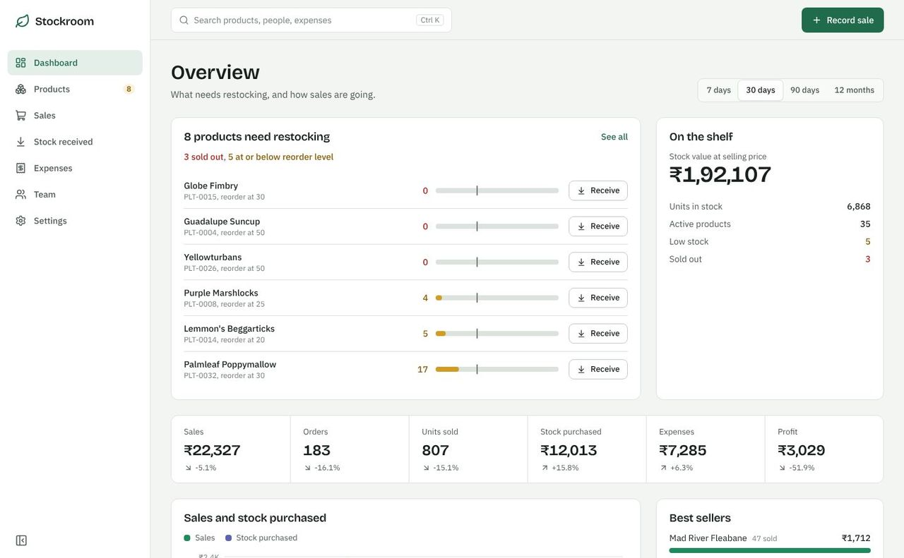
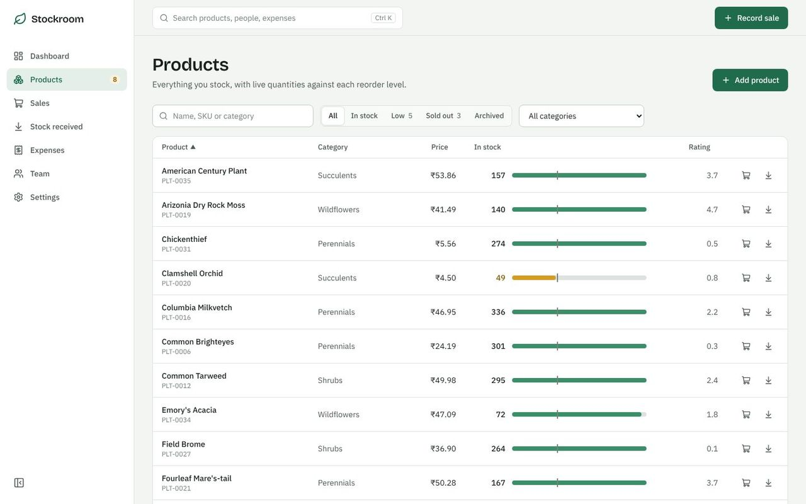
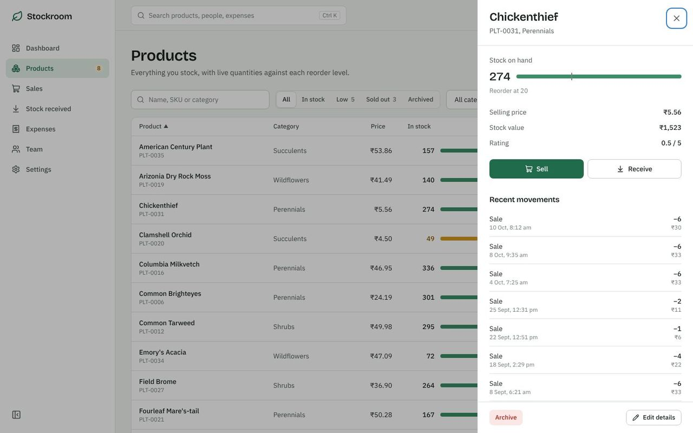
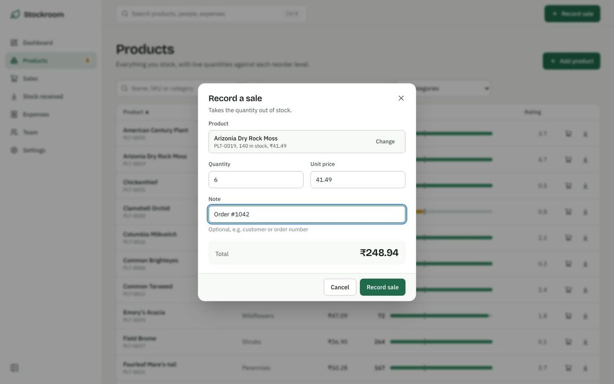
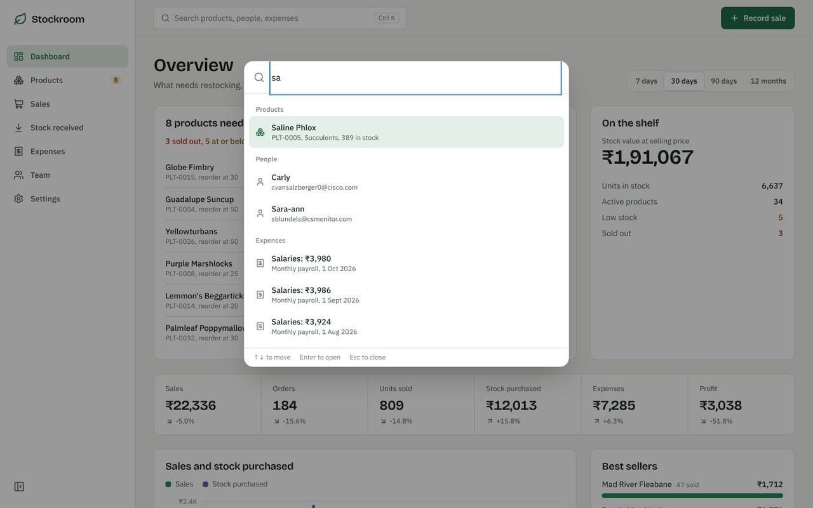
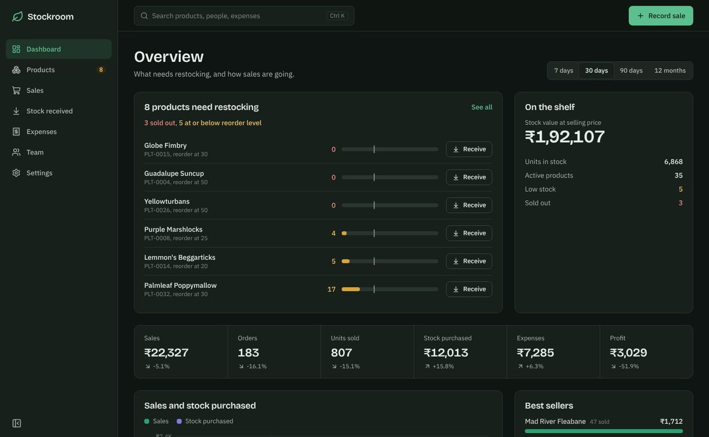
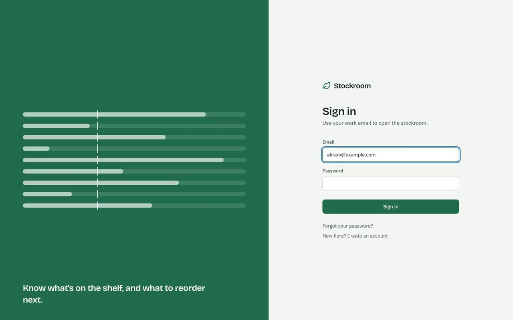
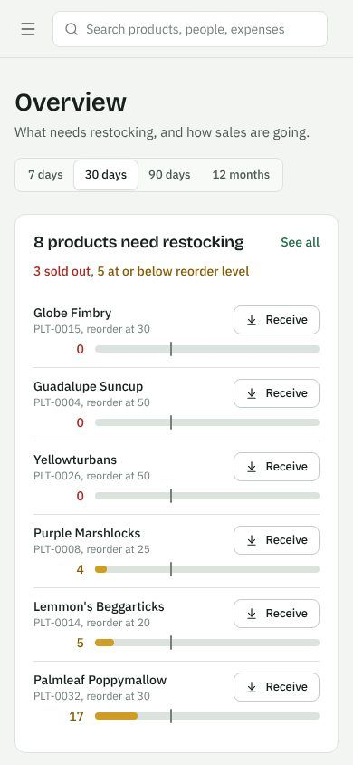
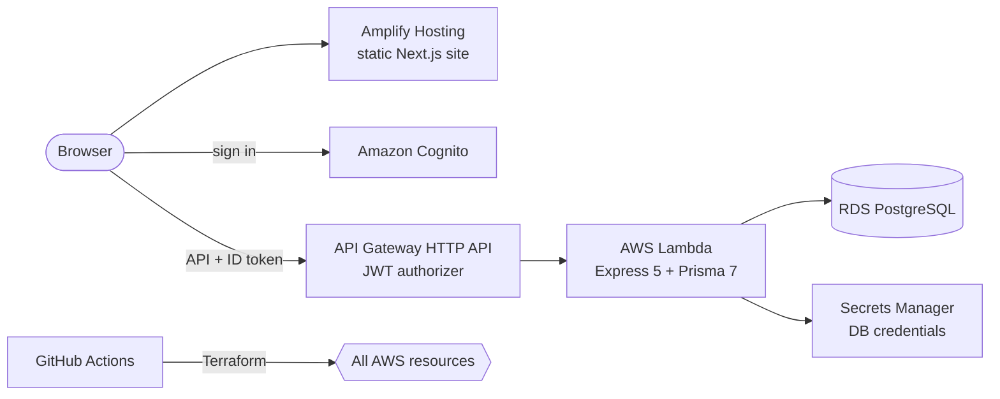

<div align="center">

# Stockroom

**Inventory management for small businesses: live stock levels, sales, deliveries and expenses,
on a fully serverless AWS stack built with Terraform.**




</div>

## Features

- **Restock at a glance.** Every product shows its stock against its reorder level; the
  dashboard opens with the items that are low or sold out, each with a one-click *Receive*.
- **Sales and deliveries that update stock.** Recording a sale takes stock out and receiving a
  delivery adds it, in a single database transaction. Overselling is blocked.
- **Live dashboard.** Sales, orders, units, stock bought, expenses and profit for 7 days, 30 days,
  90 days or 12 months, each compared with the previous period. Best sellers and expenses by
  category.
- **Search everything.** Press <kbd>Ctrl</kbd>/<kbd>⌘</kbd> + <kbd>K</kbd> to find products, SKUs,
  people and expenses from any page, or run quick actions.
- **Full product management.** Add, edit, archive and restore products with SKU, category, price,
  rating and reorder level. Archiving keeps sales history intact.
- **Sign-in and roles.** Amazon Cognito handles sign-in, sign-up, email confirmation and password
  reset. Members of the `admin` group can archive, delete and manage the team.
- **Built for every screen.** Light, dark and system themes; works on phones.

## Screenshots

| | |
|---|---|
|  |  |
| **Products** with live stock gauges, filters and sorting | **Product details** with recent movements |
|  |  |
| **Record a sale**: price filled in, total updates as you type | **Search** across products, people and expenses |
|  |  |
| **Dark theme** | **Sign in** with Amazon Cognito |

<p align="center"></p>

## Architecture



- The website is a **static export** served by Amplify; there is no web server to run.
- **API Gateway** checks the Cognito token before a request reaches **Lambda**, which runs the
  Express API inside a private VPC next to the database.
- The database password is created and rotated by **RDS in Secrets Manager**. It never appears in
  code, Terraform or CI, and the API reloads it automatically after a rotation.
- **Terraform** defines every AWS resource for a `dev` and a `prod` environment. **GitHub Actions**
  checks each pull request (format, validate, tests, tflint, checkov, plan posted as a comment)
  and deploys on push, including database migrations. AWS access uses OIDC, with no stored keys.

See [infra/README.md](infra/README.md) for the full infrastructure design, costs and runbook.

## Tech stack

| Layer | Technology |
|---|---|
| Front end | Next.js 16 (static export), React 19, TypeScript, Tailwind CSS 4, Redux Toolkit Query, Recharts, AWS Amplify (Auth) |
| API | Node.js 22, Express 5, Zod validation, Prisma 7 with the `pg` driver adapter |
| Data | PostgreSQL 16 on Amazon RDS |
| AWS | Lambda, API Gateway (HTTP API), Cognito, RDS, Secrets Manager, VPC, CodeBuild, Amplify Hosting, CloudWatch, SNS, Budgets |
| Infrastructure | Terraform (modules for network, database, auth, api, hosting, migrations, monitoring) |
| CI/CD | GitHub Actions with OIDC; tflint, checkov, `terraform test` |
| Local dev | Docker Compose |

## Project structure

```
.
├── client/                 Next.js front end
│   └── src/
│       ├── app/            pages: overview, products, sales, stock received, expenses, team, settings
│       ├── components/     app shell, search palette, dialogs, product panel, charts
│       └── state/api.ts    API client (adds the Cognito token to every call)
├── server/                 Express API, deployed to Lambda
│   ├── src/routes/         dashboard, products, sales/purchases, expenses, users, search
│   ├── src/lib/            database client, auth, errors
│   ├── prisma/             schema, migrations, demo data
│   └── test/               end-to-end API tests
├── infra/                  Terraform
│   ├── bootstrap/          state bucket, GitHub OIDC roles (one-time)
│   ├── modules/            network, database, auth, api, hosting, migrations, monitoring
│   └── envs/               dev and prod
├── .github/workflows/      PR checks and deploys
├── docker-compose.yml      local database, API and website
└── amplify.yml             Amplify build settings
```

## Getting started

### Run everything with Docker

```bash
git clone https://github.com/wasim0028/Inventory_management.git
cd Inventory_management
docker compose up --build
docker compose exec server npm run seed   # optional demo data (deletes existing data)
```

Open http://localhost:3000. Locally, sign-in is turned off and you act as an admin.

### Run without Docker

You need Node.js 22+ and a PostgreSQL database.

```bash
# 1. Database (or use any PostgreSQL you already have)
docker compose up -d db

# 2. API on http://localhost:8000
cd server
cp .env.example .env
npm install
npx prisma migrate deploy
npm run seed            # optional demo data
npm run dev

# 3. Website on http://localhost:3000 (second terminal)
cd client
cp .env.example .env.local
npm install
npm run dev
```

### Tests

```bash
# API tests against PostgreSQL (uses DATABASE_URL from server/.env)
cd server && npm test

# Offline infrastructure tests (no AWS account needed), from the repo root
cd infra/envs/dev && terraform init -backend=false && terraform test
```

## Deploying to AWS

Deployment is fully automated with Terraform and GitHub Actions:

| Branch | Environment |
|---|---|
| `develop` | dev |
| `main` | prod (with an approval step) |

After a one-time setup (a state bucket, GitHub OIDC roles, and a few GitHub settings), every
push builds the API, applies Terraform, runs database migrations and lets Amplify rebuild the
website. Follow [infra/README.md](infra/README.md) step by step.

## API

All routes except `/health` need `Authorization: Bearer <Cognito ID token>`.
Lists accept `page` and `pageSize` (max 100) and return `{ items, total, page, pageSize, pageCount }`.

| Method & path | Notes |
|---|---|
| `GET /health` | Public |
| `GET /me` | The signed-in user's email and groups |
| `GET /dashboard?range=7d\|30d\|90d\|12m` | KPIs vs previous period, series, low stock, best sellers, expenses by category |
| `GET /products?q&category&status=all\|in\|low\|out\|archived&sort&order` | |
| `GET /products/categories` | |
| `GET /products/:id` | With the latest sales and deliveries |
| `POST /products`, `PATCH /products/:id` | |
| `DELETE /products/:id`, `POST /products/:id/restore` | Admin only. Archive keeps history. |
| `GET /sales`, `POST /sales` | Sale takes stock out; 409 if not enough stock |
| `GET /purchases`, `POST /purchases` | Delivery adds stock |
| `GET /expenses`, `GET /expenses/by-category`, `POST /expenses` | |
| `DELETE /expenses/:id` | Admin only |
| `GET /users`, `POST /users`, `DELETE /users/:id` | Team list. Adding/removing is admin only. |
| `GET /search?q=` | Products, people and expenses in one call |

## Acknowledgements

The project started from Ed Roh's
[inventory management tutorial](https://github.com/ed-roh/inventory-management) and was rebuilt
with a new design, new features, a serverless architecture and Terraform infrastructure.

## Author

**Md Wasim Akram** · [GitHub @wasim0028](https://github.com/wasim0028)
