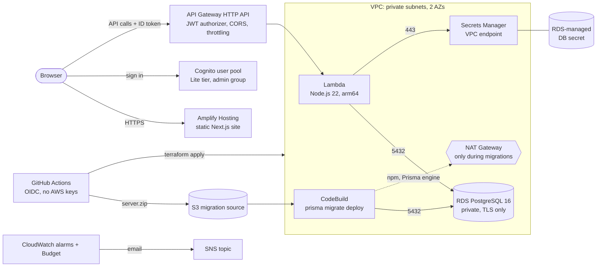

# Stockroom infrastructure (Terraform)

Everything the app needs on AWS, for two environments in **ap-south-1 (Mumbai)**:

| Environment | Git branch | Terraform root | State key |
|---|---|---|---|
| dev | `develop` | `infra/envs/dev` | `stockroom/dev/terraform.tfstate` |
| prod | `main` | `infra/envs/prod` | `stockroom/prod/terraform.tfstate` |



## What gets created

| Module | Resources |
|---|---|
| `network` | VPC, 2 private + 2 public subnets (AZs pinned by name), Internet Gateway, Secrets Manager interface endpoint, security groups (Lambda → RDS 5432 and endpoint 443 only), default SG locked down, optional flow logs, and a **NAT Gateway only when `enable_migration_nat = true`** |
| `database` | RDS PostgreSQL 16 `db.t4g.micro`, gp3, encrypted, private, `rds.force_ssl = 1`, password generated and stored by RDS in Secrets Manager (never in Terraform), backups, logs exported to CloudWatch |
| `auth` | Cognito user pool (email sign-in, Lite tier, password policy), web client (SRP + refresh, no secret), `admin` group |
| `api` | Lambda (bundle from `server/dist`), least-privilege role, log group, HTTP API with Cognito JWT authorizer, `GET /health` (public) and `ANY /{proxy+}` (signed in), CORS, throttling, JSON access logs |
| `hosting` | Amplify app connected to GitHub (monorepo root `client`, uses `amplify.yml`), branch with the `NEXT_PUBLIC_*` variables |
| `migrations` | Private S3 bucket for `server.zip`, CodeBuild project in the private subnets that runs `prisma migrate deploy` with credentials from Secrets Manager |
| `monitoring` | SNS email topic (KMS-encrypted), alarms for Lambda errors/throttles, API 5xx rate, RDS CPU/free storage/connections, monthly AWS Budget |
| `bootstrap/` | State bucket (versioned, encrypted, private, TLS only), GitHub OIDC provider, plan role (read-only) and one deploy role per environment |

### Differences between dev and prod

| Setting | dev | prod |
|---|---|---|
| RDS Multi-AZ | off | on |
| Backups | 1 day | 7 days |
| Deletion protection (RDS, Cognito) | off | on |
| Final snapshot on delete | no | yes |
| Enhanced Monitoring | off | 60 s |
| Secrets Manager endpoint AZs | 1 | 2 |
| VPC flow logs (rejected traffic) | off | on |
| Log retention | 14 days | 30 days |
| CORS origins | Amplify site + `http://localhost:3000` | Amplify site only |
| Monthly budget alert | $30 | $60 |

## Prerequisites

- An AWS account and an admin user or role on your computer for the one-time bootstrap
  (`aws configure` or `aws sso login`).
- Terraform **1.10 or later** (CI uses 1.16.6), Node.js 22 and the AWS CLI.
- Admin access to the GitHub repository.
- A **GitHub token for Amplify**. Fine-grained token for this repo with *Contents: read*,
  *Metadata: read* and *Webhooks: read and write*, or a classic token with `repo` and
  `admin:repo_hook`.

## One-time setup

### 1. Bootstrap the account

```bash
cd infra/bootstrap
terraform init
terraform apply          # add -var create_github_oidc_provider=false if the account already has one
terraform output
```

Keep the outputs: `state_bucket`, `plan_role_arn`, `deploy_role_arns`.

The bootstrap keeps its own state in `infra/bootstrap/terraform.tfstate` (git-ignored).
Back it up, or move it into the new bucket: add
`backend "s3" { bucket = "<state_bucket>" key = "stockroom/bootstrap/terraform.tfstate" region = "ap-south-1" use_lockfile = true }`
to `bootstrap/main.tf` and run `terraform init -migrate-state`.

### 2. Configure GitHub

In the repository's **Settings**:

1. **Environments** → create `dev` and `prod`. On `prod`, add yourself under
   *Required reviewers* so production deploys wait for approval.
2. **Secrets and variables → Actions**:

   | Where | Type | Name | Value |
   |---|---|---|---|
   | Repository | Variable | `TF_STATE_BUCKET` | `state_bucket` output |
   | Repository | Variable | `AWS_PLAN_ROLE_ARN` | `plan_role_arn` output |
   | Repository | Variable | `ALERT_EMAIL` | where alarms and budget emails go |
   | Repository | Secret | `AMPLIFY_GITHUB_TOKEN` | the GitHub token for Amplify |
   | Environment `dev` | Variable | `AWS_DEPLOY_ROLE_ARN` | `deploy_role_arns.dev` |
   | Environment `prod` | Variable | `AWS_DEPLOY_ROLE_ARN` | `deploy_role_arns.prod` |

3. Create the `develop` branch from `main` if it doesn't exist yet.

### 3. First deploy

Push to `develop` (or run **Actions → Deploy → Run workflow → dev**). The workflow:

1. builds the Lambda bundle,
2. runs `terraform apply` with the temporary NAT Gateway **on**,
3. uploads `server/` to S3 and runs the CodeBuild migration project,
4. runs `terraform apply` again with the NAT Gateway **off** (even if a step failed),
5. starts the first Amplify build. Later builds start on every push.

The deploy summary shows the website and API URLs. Then:

- **Confirm the SNS subscription** from the email AWS sends to `ALERT_EMAIL`.
- **Activate the cost allocation tag**: Billing → Cost allocation tags → activate
  `Environment` (it appears up to 24 hours after the first tagged resources exist).
  The budget filters on this tag and shows $0 until it is active.
- **Create your first user** (next section).

When dev works, open a pull request from `develop` to `main`. After it merges, the deploy to
`prod` waits for your approval.

### Create the first admin user

```bash
POOL=$(terraform -chdir=infra/envs/dev output -raw user_pool_id)
aws cognito-idp admin-create-user --user-pool-id "$POOL" \
  --username you@example.com \
  --user-attributes Name=email,Value=you@example.com Name=email_verified,Value=true \
  --desired-delivery-mediums EMAIL
aws cognito-idp admin-add-user-to-group --user-pool-id "$POOL" \
  --username you@example.com --group-name admin
```

Cognito emails a temporary password; the app asks for a new one at first sign-in.
(Running `terraform output` locally needs `terraform init -backend-config=backend.hcl` first.)

## Working with it

### Pull requests

Every PR that touches `infra/` or `server/` runs `terraform fmt`, `validate`, the offline
tests (`terraform test`), `tflint` and `checkov`, then a real `terraform plan` for dev and
prod with the read-only role. The plans are posted as PR comments and updated on each push.

### Running Terraform from your computer

```bash
cd server && npm ci && npm run build && cd ..        # Terraform zips server/dist
cd infra/envs/dev
cp backend.hcl.example backend.hcl                   # set the bucket name
cp terraform.tfvars.example terraform.tfvars         # set alert_email
export TF_VAR_github_access_token=<token>            # never in a file
terraform init -backend-config=backend.hcl
terraform plan
```

Use the same NAT-on → migrate → NAT-off sequence as the workflow if you apply locally.

### Database migrations

Migrations are the SQL files in `server/prisma/migrations`, applied by
`prisma migrate deploy`. To rerun them by hand:

```bash
cd infra/envs/dev
terraform apply -var enable_migration_nat=true
(cd ../../../server && zip -qr ../server.zip . -x 'node_modules/*' 'dist/*' 'src/generated/*')
VERSION=$(aws s3api put-object --bucket "$(terraform output -raw migration_source_bucket)" \
  --key server.zip --body ../../../server.zip --query VersionId --output text)
aws codebuild start-build --project-name "$(terraform output -raw migration_project_name)" \
  --source-version "$VERSION"
# wait for the build to finish (CodeBuild console or batch-get-builds), then:
terraform apply -var enable_migration_nat=false
```

The new Lambda code is deployed in the same apply that turns the NAT on, a minute or two
before migrations finish. Keep migrations backward compatible (add columns before code uses
them; remove them in a later release).

### Run the checks locally

```bash
cd infra
terraform fmt -check -recursive
for d in bootstrap envs/dev envs/prod; do terraform -chdir=$d init -backend=false && terraform -chdir=$d validate; done
terraform -chdir=envs/dev test && terraform -chdir=envs/prod test   # offline, mocked AWS
tflint --init && tflint --recursive
checkov -d . --framework terraform --compact --quiet
```

## Rollback

| What went wrong | What to do |
|---|---|
| Bad application code | Revert the commit and push. The workflow redeploys the previous Lambda bundle; Amplify rebuilds the previous site (or use *Redeploy this version* in the Amplify console). |
| Bad infrastructure change | Revert the Terraform change and push; the next apply returns resources to the previous configuration. |
| Bad data or a destructive migration | Prisma migrations only go forward. Restore the database with RDS point-in-time recovery to a new instance, check it, then point `DB_HOST` at it (or rename instances). Prod keeps 7 days of backups. |
| Corrupted Terraform state | The state bucket is versioned: restore the previous version of the state object in the S3 console. |
| NAT Gateway left running | Run `terraform apply -var enable_migration_nat=false` in that environment. |

## Destroy dev

```bash
cd infra/envs/dev
terraform destroy
```

Dev has deletion protection off and no final snapshot, so this removes everything,
including the database. Prod needs `db_deletion_protection = false` and
`cognito_deletion_protection = false` applied first, and leaves a final snapshot.
The bootstrap bucket has `prevent_destroy` and is meant to stay.

## Estimated monthly cost

Rough figures for ap-south-1 at low traffic, before free-tier credits. Prices change; check
the [AWS Pricing Calculator](https://calculator.aws/) for current numbers.

| Item | dev | prod |
|---|---|---|
| RDS db.t4g.micro (instance) | ~$15 (single-AZ) | ~$30 (Multi-AZ) |
| RDS storage 20 GB gp3 | ~$3 | ~$6 |
| Secrets Manager VPC endpoint | ~$8 (1 AZ) | ~$16 (2 AZs) |
| Secrets Manager secret, KMS key (alerts), CloudWatch alarms | ~$2 | ~$2 |
| Lambda, API Gateway, Cognito (under 10,000 users), CloudWatch Logs | ~$0–2 | ~$1–3 |
| Amplify Hosting (builds + traffic) | ~$1 | ~$1–3 |
| Temporary NAT Gateway | ~$0.06 per deploy | ~$0.06 per deploy |
| **Total** | **about $30** | **about $55–60** |

A permanent NAT Gateway would add roughly $35–45 per environment per month.

## Security notes

- **No AWS keys in GitHub.** Workflows use OIDC. The plan role is read-only and only usable
  from pull requests; each deploy role only from its GitHub environment.
- **Deploy roles use `PowerUserAccess`** (everything except IAM and account management) plus
  IAM rights limited to roles named `stockroom-<env>-*`. Terraform creates many kinds of
  resources, so a tighter policy would break often; narrow it further if your organisation
  requires.
- **The database password is never in Terraform.** RDS generates it, stores it in Secrets
  Manager and rotates it every 7 days. The API reloads it automatically when the database
  rejects the old one (one request gets a 503, then it recovers).
- **The GitHub token is in Terraform state.** Amplify requires it and AWS gives no way to keep
  it out. The state bucket is private, encrypted, TLS-only and versioned; limit who can read it.
- **Tokens and personal data stay out of Git.** `terraform.tfvars` and `backend.hcl` are
  git-ignored. CI passes the email and token as `TF_VAR_*` environment variables.

### checkov findings skipped on purpose

Each skip is written next to the resource in the code with its reason.

| Check | Where | Reason |
|---|---|---|
| CKV_AWS_290, CKV_AWS_355 | Lambda and CodeBuild IAM policies | Only EC2 ENI/describe and X-Ray actions use `*`; AWS does not support resource-level permissions for them |
| CKV_AWS_293, CKV_AWS_157, CKV_AWS_118 | RDS | Deletion protection, Multi-AZ and Enhanced Monitoring are variables: on in prod, off in dev |
| CKV_AWS_353 | RDS | Performance Insights is optional to keep costs down |
| CKV2_AWS_30 | RDS | Slow queries are logged with `log_min_duration_statement` |
| CKV2_AWS_5 | Security groups | Attached in other modules, which checkov can't follow |
| CKV_AWS_158, CKV_AWS_338 | Log groups | CloudWatch Logs encrypts by default; retention is 14/30 days, not a year |
| CKV_AWS_116, CKV_AWS_115, CKV_AWS_272, CKV_AWS_173 | Lambda | No DLQ for synchronous calls; reserved concurrency is a variable (new accounts may have a limit of 10); no code signing; environment variables hold no secrets |
| CKV_AWS_309 | `GET /health` route | Public on purpose, returns no data |
| CKV_AWS_145, CKV_AWS_18, CKV_AWS_144, CKV2_AWS_62 | S3 buckets | SSE-S3 instead of a KMS key; no access logging, replication or event notifications needed |
| CKV_AWS_147 | CodeBuild | No build artifacts are produced |

## Things you must do by hand

1. Run `infra/bootstrap` once with admin credentials and keep its state safe.
2. Create the GitHub token for Amplify and the GitHub environments, variables and secret.
3. Create the `develop` branch.
4. Confirm the SNS email subscription for each environment.
5. Activate the `Environment` cost allocation tag in Billing.
6. Create the first Cognito user and add it to the `admin` group.
